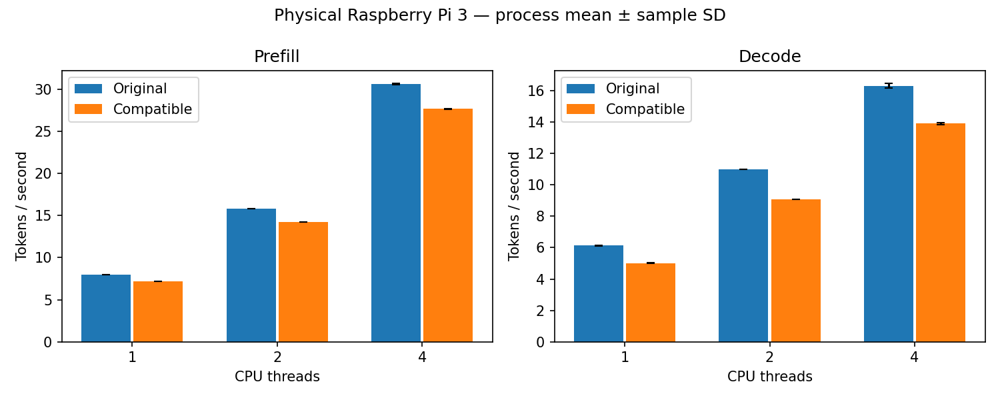

# Physical Pi 3 end-to-end performance decision

The upstream-order compatible Q5 row4 integration is **rejected as a performance
improvement for this workload**. All four process pairs in each of the six
phase/thread groups were slower than the unchanged original engine. Keep the
compile-time and runtime integration defaults off and use the original engine.
The numerical gate passes; that alone does not establish an optimization.

## Measured result

The physical Raspberry Pi 3 Model B Rev 1.2 ran Debian 13 ARM64 with four
Cortex-A53 cores and approximately 905 MiB RAM. Capture ran on 2026-10-31 from
16:41:12 to 17:01:26 UTC, using clean project source
`41e5357d98e41a12439ac24f51221070fb64cd24`. The pinned llama.cpp commit is
`a7a98e0fffed794396b3fbad4dcdbbc184963645`; the verified model is
SmolLM2-135M-Instruct Q4_K_M. Original binary/library hashes were preserved.

| Phase | Threads | Original mean t/s | Compatible mean t/s | Paired throughput change |
|---|---:|---:|---:|---:|
| Prefill | 1 | 7.993595 | 7.200320 | -9.924% |
| Prefill | 2 | 15.849409 | 14.266823 | -9.985% |
| Prefill | 4 | 30.668652 | 27.701921 | -9.673% |
| Decode | 1 | 6.132410 | 5.019603 | -18.146% |
| Decode | 2 | 11.004110 | 9.077879 | -17.505% |
| Decode | 4 | 16.321701 | 13.906987 | -14.788% |

Changes are throughput reductions, not latency percentages. Each change is the
mean of four within-pair compatible/original throughput ratios, minus one.
The [generated report](../reports/pi3-e2e-20261031/e2e.md) includes sample standard
deviations. [JSON](../reports/pi3-e2e-20261031/e2e.json) retains all pairs;
[CSV](../reports/pi3-e2e-20261031/e2e.csv) identifies every raw file, SHA256,
row, repetition and integer duration.

## Controls and correctness

Four sessions alternate original/compatible and compatible/original order;
thread order reverses in alternate sessions. Threads 1/2/4 each have four pairs,
three native repetitions per process: 24 formal processes and 144 separate
prefill/decode throughput observations. Both builds use Release, ARMv8-A,
OpenMP/llamafile, batch/ubatch 128, mmap enabled, poll 0, GPU layers 0 and official
warmup. Native configuration fields are compared before reporting.

The pinned official random-token harness measures pp128 and tg16 separately.
Decode starts at depth 0; it does not follow the separate 128-token prefill test
and is not greedy application generation. Formal candidate processes explicitly
enable the compatible profile with audit counters disabled. Both binaries and
resolved shared libraries are hashed before and after collection.

Before timing, the model numerical gate repeated 72 executions across two public
prompts at 1/4 threads. All 36 original/compatible comparisons had zero measured
logit difference and matching greedy tokens. Two pp32/tg8 smoke processes and six
separate no-warmup audited proof processes passed. The proofs establish candidate
dispatch during prefill and decode at every thread count. Numerical, smoke and
proof executions are excluded from performance statistics.

The earlier direct FMA prototype failed the fixed model tolerance. Its standalone
kernel ratios cannot be transferred to this compatible implementation. See the
[numerical integration study](ggml_integration_analysis.md).

## Operating conditions and failure evidence

All 24 formal processes exited normally. There were 1,140 formal lifecycle sensor
samples: all observed frequencies were 1,200 MHz; maximum temperature was
77.364 degrees Celsius. Every throttle reading was `0x20000`, a historical
frequency-cap flag; no current throttle/power flags were sampled. These snapshots
cannot exclude short unsampled events, and the temperature approached the device's
thermal limit. Peak direct-child lifecycle RSS was 130.8671875 MiB.

No timeout or kill was observed. Cgroup OOM evidence was unavailable and remains
null with its reason; absence of an observed failure does not prove an OOM counter
was zero. No affinity, governor, cooling, clock, voltage or swap setting was changed.
Lifecycle monitoring includes initialization, warmup and teardown, so sensor
samples and peak RSS cannot be attributed to individual timed phases.

## Interpretation and limits

This is a negative result for the whole integrated build, including its wrapper,
dispatch and inference overhead. It does not isolate the cause of the regression.
The data do not establish that arithmetic order, register pressure, caches,
threading or temperature alone caused the slowdown. No additional tuning or
experiments are included in this milestone.

One board, one model, one pp/tg configuration and four paired process means per
group limit generalization. Standard deviations are descriptive, not confidence
intervals. AB/BA ordering reduces order bias but does not control all scheduler
or temperature drift. The result does not invalidate separate synthetic FP32 or
packed-kernel measurements; it demonstrates why those are insufficient to claim
an LLM speedup. No accepted end-to-end LLM acceleration has been demonstrated.

The [capture manifest](../results/integration/e2e-20261031/manifest.json),
[publication review](../results/integration/e2e-20261031/SOURCE.json),
[field review](ggml_evidence_review.md) and
[reproduction protocol](e2e_performance.md) document provenance and replay.
Complete stderr, loader paths and compiler dumps remain private. The retained
native, process, sensor and manifest bytes match the original Pi capture.
