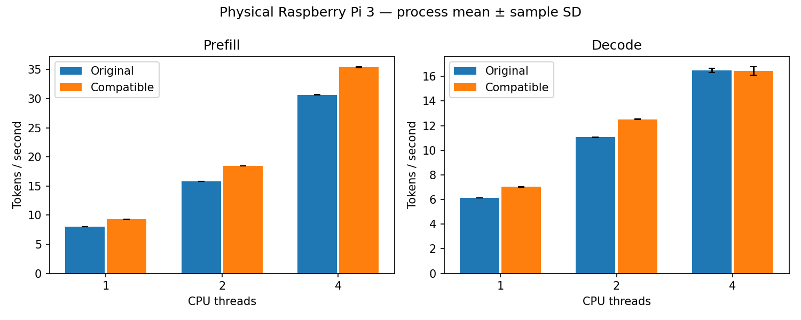

# Physical Pi 3: the thread-adaptive two-row candidate is accepted end to end

The thread-adaptive candidate is **accepted under the rule committed before
measurement**. Prefill throughput rose 15.5–17.0% at every thread count and decode
rose 14.6% at one thread and 13.1% at two. Four-thread decode was unchanged (-0.31%),
inside its 1% non-inferiority margin. Compile-time and runtime integration defaults
remain off.

As with the plain candidate, this does **not** raise the board's highest decode
throughput, and acceptance says only that the candidate beats the original engine.

## Measured result

Capture ran on 2026-11-12 from 07:02:39 to 07:20:32 UTC on the Raspberry Pi 3 Model B
Rev 1.2, from clean source `9c83ffb08e101a12b0ee4952c826040ba5d814af`, which contains
the [protocol and decision rule](q5_adaptive.md).

| Phase | Threads | Original mean t/s | Candidate mean t/s | Paired throughput change | Pairs favouring candidate | Requirement | Rule |
|---|---:|---:|---:|---:|---:|---|---|
| Prefill | 1 | 7.990906 | 9.346278 | +16.961% | 4/4 | improve | passes |
| Prefill | 2 | 15.841280 | 18.453599 | +16.491% | 4/4 | improve | passes |
| Prefill | 4 | 30.684214 | 35.430441 | +15.468% | 4/4 | improve | passes |
| Decode | 1 | 6.129517 | 7.023840 | +14.590% | 4/4 | improve | passes |
| Decode | 2 | 11.058734 | 12.504980 | +13.078% | 4/4 | improve | passes |
| Decode | 4 | 16.489803 | 16.439563 | -0.309% | 2/4 | within 1% | passes |

Each change is the mean of four within-pair candidate/original throughput ratios,
minus one. The generated [report](../reports/pi3-adaptive-e2e-20261112/e2e.md) labels
the candidate column "compatible" because the report code is unchanged. The
[verdict file](../reports/pi3-adaptive-e2e-20261112/two_row_gate.json) records the
rule and each group's outcome.

## Dispatch followed the thread count

The audited proofs show the policy doing what it was designed to do. At one and two
threads every candidate call was hinted, 1,060,032 in prefill and 135,552 in decode,
with no plain call. At four threads every call was plain, with no hinted call. The
bridge reported four processors.

## Against the other two-row captures

These are separate captures, each paired only with the original, so the differences
below are observations and not a paired comparison.

| Group | Prefetching | Plain | Thread-adaptive |
|---|---:|---:|---:|
| Prefill, 1 thread | +18.2% | +17.6% | +17.0% |
| Prefill, 2 threads | +17.6% | +17.3% | +16.5% |
| Prefill, 4 threads | +16.6% | +16.9% | +15.5% |
| Decode, 1 thread | +15.9% | +11.8% | +14.6% |
| Decode, 2 threads | +13.8% | +10.2% | +13.1% |
| Decode, 4 threads | -2.5% | -0.1% | -0.3% |

The adaptive candidate recovers most of the decode gain the plain loop gave up at one
and two threads while keeping four-thread decode level. Its prefill figures are 0.6
to 1.4 points below the plain capture's at every thread count, including four
threads, where both run the same plain loop. That gap is not explained here; the
adaptive build is a different library with a per-call mode switch, and
capture-to-capture variation has not been measured. Which candidate is preferable
depends on whether decode at one and two threads or prefill matters more, and this
data does not settle it.

## Controls and correctness

All 24 formal processes exited normally, giving 144 throughput samples with no
exclusions. The original binary and its four libraries matched the hashes of the
earlier end-to-end studies. The pinned graph harness passed on the Pi build, which
exercises both modes because it runs at 1, 2 and 4 threads. The model gate had zero
logit difference over 36 comparisons with matching greedy tokens.

## Operating conditions

Conditions were clean by the rule. All 1,011 sensor samples read `throttled=0x0` at
1,200 MHz with none missing. Maximum temperature was 78.440 degrees Celsius, the
highest of the two-row captures, with 47 samples at or above 75; cooling was not
changed. One-second sampling cannot exclude shorter events.

## Limits

The rule that chooses hints, fewer threads than processors, was fitted to this
four-core board. The three-thread case, where hints are issued, was audited by rule
but not timed in this capture. One board, one small model, random-token pp128/tg16
and four process pairs per group limit generalization. Standard deviations in the
report are descriptive.
