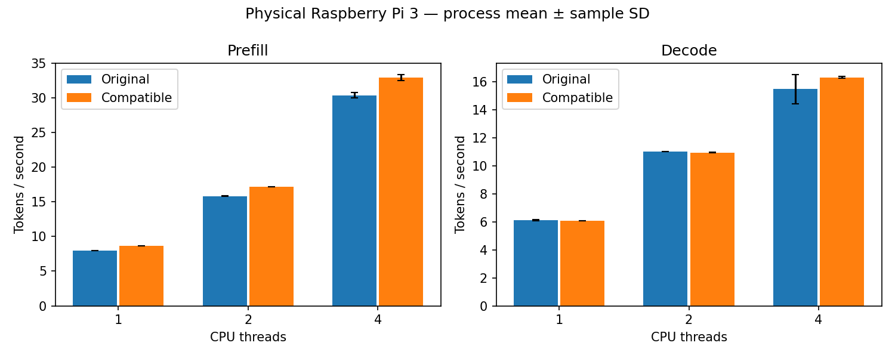

# Physical Pi 3: the hybrid dispatch candidate is accepted end to end

The hybrid dispatch candidate is **accepted under the rule committed before
measurement**. Prefill throughput rose 8.4–8.7% at every thread count, and decode
stayed within the 1% non-inferiority margin. This is a prefill gain with decode
unchanged in substance; it is **not a decode speedup**, and one decode group needs the
qualification below. Compile-time and runtime integration defaults remain off.

## Measured result

Capture ran on 2026-11-11 from 23:21:02 to 23:39:34 UTC on the Raspberry Pi 3 Model B
Rev 1.2, from clean source `fc6b96e14a2b3524a6e5a2b58b4abcc4b2df88ea`, which contains
the [protocol and decision rule](q5_hybrid_dispatch.md).

| Phase | Threads | Original mean t/s | Candidate mean t/s | Paired throughput change | Pairs favouring candidate | Rule |
|---|---:|---:|---:|---:|---:|---|
| Prefill | 1 | 7.989080 | 8.682032 | +8.674% | 4/4 | passes |
| Prefill | 2 | 15.835092 | 17.159562 | +8.364% | 4/4 | passes |
| Prefill | 4 | 30.387305 | 32.951953 | +8.459% | 4/4 | passes |
| Decode | 1 | 6.117573 | 6.087211 | -0.495% | 1/4 | passes |
| Decode | 2 | 11.019416 | 10.959493 | -0.543% | 0/4 | passes |
| Decode | 4 | 15.486426 | 16.326954 | +5.800% | 2/4 | passes, qualified |

Each change is the mean of four within-pair candidate/original throughput ratios,
minus one. The generated [report](../reports/pi3-hybrid-e2e-20261111/e2e.md) labels
the candidate column "compatible" because the report code is unchanged. The
[verdict file](../reports/pi3-hybrid-e2e-20261111/hybrid_gate.json) records the rule
and each group's outcome.

## The four-thread decode figure is not a gain

The +5.8% in four-thread decode comes from two slow repetitions of the **original**,
not from the candidate. In sessions 2 and 3, one of the original's three repetitions
read 11.10 and 10.91 t/s where every other four-thread decode repetition in the
capture, for both variants, read between 16.02 and 16.54 t/s. Decode calls never reach
the candidate loop, so no mechanism exists for the candidate to be faster there.

All 144 samples are retained and the verdict uses them all. As a sensitivity check
only: without those two repetitions the four pair ratios are 0.9932, 0.9955, 0.9926
and 1.0053, a mean change of about -0.34%, in line with the other decode groups and
still inside the margin. The verdict does not depend on the outliers.

The cause was not established. No supply or throttle flag was sampled. During this
capture the development host polled the board over SSH more often than in earlier
captures, and a login competes for a core when all four are busy; that is a plausible
source of brief interference and is unverified. Later captures poll over a single
connection instead.

## Controls and correctness

All 24 formal processes exited normally, giving 144 throughput samples with no
exclusions. The original binary and its four libraries matched the hashes of both
earlier end-to-end studies. The timed candidate libraries were hashed before and
after timing and recorded in the capture.

Every gate ran on the timed library before timing:

- Graph harness: 108 executions over 18 layouts matched the disabled path bit for
  bit, with candidate and declined rows covering every output exactly.
- Model gate: 36 comparisons with zero logit difference and matching greedy tokens.
  Multi-token steps reached the candidate; single-token steps were declined entirely.
- Audited proofs at 1, 2 and 4 threads: prefill made 1,059,840 candidate calls and
  declined 192 single-vector calls; decode made no candidate call and declined all
  135,552.

## Operating conditions

Conditions met the rule's definition of clean: all 1,045 lifecycle sensor samples
read `throttled=0x0` at 1,200 MHz, with none missing. Maximum temperature was 77.902
degrees Celsius and 51 samples were at or above 75, as close to the firmware's soft
limit as in earlier captures. Cooling was not changed. One-second sampling cannot
exclude shorter events.

## Interpretation and limits

The hybrid keeps the two-block loop's prefill gain and removes its decode loss by not
using it in decode. Decode at one and two threads is about 0.5% slower, with seven of
eight pairs favouring the original. That is consistent with a small cost for the
declined bridge call and close to the 0.23–0.41% measured earlier for a compiled-in
but disabled bridge; this capture does not isolate it.

For text generation, where most time is spent in decode, the practical effect is
therefore limited to prompt processing. No explanation of why the loop loses on
single-vector blocks is established here; the
[reuse diagnostic](q5_reuse_diagnostic.md) addresses that separately.

Only two regimes were timed: 16 vectors per block and one. Blocks serving 2–15
vectors were tested for correctness only, so the threshold of two is not a measured
optimum. One board, one small model, random-token pp128/tg16 and four process pairs
per group limit generalization. Standard deviations in the report are descriptive.
