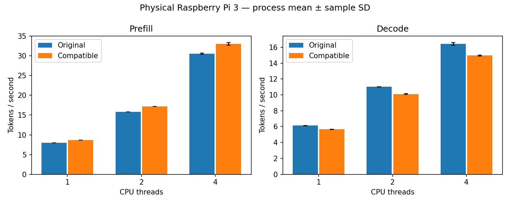

# Physical Pi 3: the two-block candidate is rejected end to end

The two-block candidate is **rejected under the rule committed before measurement**.
Prefill throughput rose at every thread count, but decode throughput fell at every
thread count, and the rule required all six phase/thread groups to improve. Keep the
compile-time and runtime integration defaults off and use the original engine. No
LLM speedup is claimed.

## Measured result

Capture ran on 2026-11-11 from 20:37:52 to 20:56:26 UTC on the Raspberry Pi 3 Model B
Rev 1.2, from clean source `bdb6fd7a66e1b6104a7c1683da9512e65b7900b6`, which is the
commit that fixed the [protocol and decision rule](q5_two_block_e2e.md).

| Phase | Threads | Original mean t/s | Candidate mean t/s | Paired throughput change | Pairs favouring candidate |
|---|---:|---:|---:|---:|---:|
| Prefill | 1 | 7.990885 | 8.693607 | +8.794% | 4/4 |
| Prefill | 2 | 15.838462 | 17.193335 | +8.554% | 4/4 |
| Prefill | 4 | 30.553720 | 33.072345 | +8.248% | 4/4 |
| Decode | 1 | 6.126332 | 5.654807 | -7.696% | 0/4 |
| Decode | 2 | 11.015283 | 10.100809 | -8.302% | 0/4 |
| Decode | 4 | 16.413113 | 14.947731 | -8.922% | 0/4 |

Each change is the mean of four within-pair candidate/original throughput ratios,
minus one. The generated [report](../reports/pi3-two-block-e2e-20261111/e2e.md) and
its files label the candidate column "compatible", because the unchanged report code
produced them; the timed library is the two-block candidate, verified by hash. The
[verdict file](../reports/pi3-two-block-e2e-20261111/two_block_gate.json) records the
rule and each group's outcome.

## Controls and correctness

All 24 formal processes exited normally, giving 144 throughput samples with no
exclusions. The timed `libggml-cpu.so` and `libggml-base.so` matched the library that
passed the kernel and model-logit gates, before and after timing. The original binary
and its four libraries matched the hashes recorded in the
[first end-to-end study](e2e_performance_analysis.md), and the original's throughput
is within 0.6% of that study in every group.

Before timing, the model gate repeated on this build: 36 comparisons had zero logit
difference and matching greedy tokens. Two smoke processes and six audited no-warmup
proofs passed, establishing candidate dispatch in prefill and decode at 1, 2 and 4
threads. These are excluded from the statistics.

## Operating conditions

Conditions met the rule's definition of clean. All 1,049 lifecycle sensor samples
read `throttled=0x0` at 1,200 MHz, with none missing. The board had been rebooted
before the capture, so this also shows no under-voltage, frequency-cap or throttling
flag was latched since boot. One-second sampling cannot exclude shorter events.

Maximum temperature was 77.902 degrees Celsius, and 41 samples were at or above 75.
That is close to the firmware's soft limit, as in the first end-to-end study. No flag
was raised, but cooling was not improved and the margin is small. No affinity,
governor, clock, voltage, cooling or swap setting was changed.

## Interpretation and limits

The split between phases is the main finding. The kernel study showed the candidate
winning when many rows are processed per call and losing by about 7% at one row per
call. Prefill of 128 tokens and single-token decode plausibly sit on opposite sides
of that boundary, which would match the sign of both results. **This capture does not
test that explanation**: it measures whole-process throughput and records no per-call
shape counts.

Compared with the earlier compatible loop, which lost 9.7–10.0% in prefill and
14.8–18.1% in decode, the candidate reverses the prefill loss and roughly halves the
decode loss. Those figures come from separate captures eleven days apart and are not
a paired comparison.

One board, one small model, random-token pp128/tg16 and four process pairs per group
limit generalization. Standard deviations in the report are descriptive, not
confidence intervals. Decode starts at depth 0 and is not greedy application
generation.

## Capture history

A first attempt, `two-block-e2e-20261111-01`, stopped in preflight before the model
gate, any smoke process or any timed process: the candidate checkout had no pinned
engine checkout or setup record for the runner to verify. Both were linked from the
baseline checkout through ignored paths and the capture was restarted under a new
name. Its manifest hash is kept in the
[publication review](../results/integration/two-block-e2e-20261111/SOURCE.json),
which also hashes the private stderr, help and loader files.

## Next bounded question

A dispatch that uses the candidate only for multi-row calls and leaves single-row
calls on the original path could, in principle, keep the prefill gain without the
decode loss. That is a new candidate needing its own predeclared gates; nothing here
measures it.
