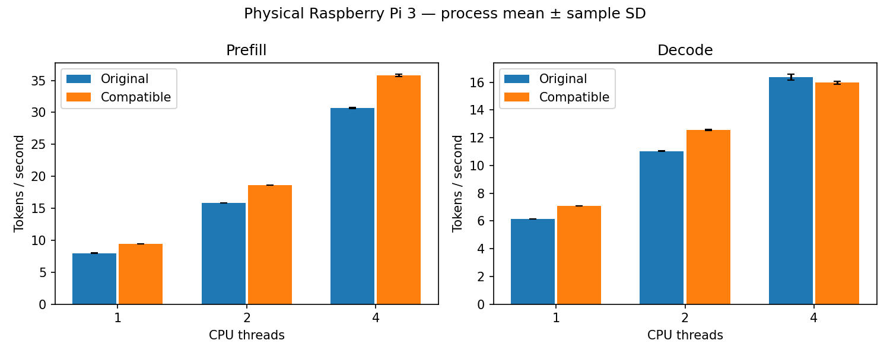

# Physical Pi 3: the two-row loop is rejected on four-thread decode alone

The two-row prefetching candidate **passed its kernel gate and is rejected end to end
under the rule committed before measurement**. Five of the six phase/thread groups
were 13.8–18.2% faster than the original engine with every pair favouring the
candidate. Four-thread decode was 2.5% slower with no pair favouring it, and the rule
required all six. Integration defaults stay off and no LLM speedup is claimed.

## Kernel gate: passed

Capture ran on 2026-11-12 from 01:50:45 to 01:53:48 UTC from clean source
`8e61bcf45b90e7c54ce983b0c4caeae3be5b19eb`, on the engine-built library. Ratios above 1
mean the candidate was faster.

| Weights | Vectors per block | Original ns/row | Candidate ns/row | Original/candidate | Candidate wins |
|---:|---:|---:|---:|---:|---:|
| 76 KB | 1 | 650.10 | 501.36 | 1.2967 | 18/18 |
| 76 KB | 16 | 637.84 | 496.39 | 1.2849 | 18/18 |
| 608 KB | 1 | 660.72 | 506.65 | 1.3041 | 18/18 |
| 608 KB | 16 | 641.68 | 497.79 | 1.2891 | 18/18 |
| 6.5 MB | 1 | 671.73 | 510.57 | 1.3157 | 18/18 |
| 6.5 MB | 16 | 642.37 | 498.34 | 1.2890 | 18/18 |
| 104 MB | 1 | 671.49 | 507.76 | 1.3224 | 18/18 |
| 104 MB | 16 | 643.36 | 499.05 | 1.2892 | 18/18 |

The candidate cost 496–511 ns per row in every shape, including the single-pass
shapes where the two-block loop cost 746–762. This is one thread on synthetic
buffers. See the [report](../reports/pi3-q5-two-row-kernel-20261112/reuse.md) and
[evidence](../results/quantized/two-row-kernel-20261112).

## End-to-end gate: rejected

Capture ran from 01:55:49 to 02:13:34 UTC from the same source, on the library whose
hashes the kernel capture recorded.

| Phase | Threads | Original mean t/s | Candidate mean t/s | Paired throughput change | Pairs favouring candidate | Rule |
|---|---:|---:|---:|---:|---:|---|
| Prefill | 1 | 7.986403 | 9.436923 | +18.163% | 4/4 | passes |
| Prefill | 2 | 15.842923 | 18.627784 | +17.579% | 4/4 | passes |
| Prefill | 4 | 30.676445 | 35.779506 | +16.635% | 4/4 | passes |
| Decode | 1 | 6.128504 | 7.100033 | +15.853% | 4/4 | passes |
| Decode | 2 | 11.033554 | 12.559637 | +13.830% | 4/4 | passes |
| Decode | 4 | 16.372605 | 15.967183 | -2.464% | 0/4 | **fails** |

Each change is the mean of four within-pair candidate/original throughput ratios,
minus one. The generated [report](../reports/pi3-two-row-e2e-20261112/e2e.md) labels
the candidate column "compatible" because the report code is unchanged. The
[verdict file](../reports/pi3-two-row-e2e-20261112/two_row_gate.json) records the
rule and each group's outcome.

## Four-thread decode

The four pair ratios were 0.9676, 0.9647, 0.9943 and 0.9749. The loss is small but
consistent, and it is the only group where the candidate did not win.

The original's own scaling differs between phases in this capture. From one to four
threads, prefill throughput rises 3.84 times and decode 2.67 times. The candidate's
decode reaches 7.10 and 12.56 t/s at one and two threads and then 15.97 at four,
close to the original's 16.37. One reading is that four-thread decode is limited by
something the threads share, such as memory traffic, so that a faster loop gains
nothing and its read-ahead hints add load. **That reading is not tested here**: the
kernel gate is single-threaded and no performance counter is read.

## Controls and correctness

All 24 formal processes exited normally, giving 144 throughput samples with no
exclusions. The original binary and its four libraries matched the hashes of the
earlier end-to-end studies. The pinned graph harness passed on the Pi build. The
model gate had zero logit difference over 36 comparisons with matching greedy tokens.
Audited proofs showed candidate dispatch in both phases at 1, 2 and 4 threads, with
16 rows per call.

## Operating conditions

Conditions were clean by the rule. All 1,004 end-to-end sensor samples and all 384
kernel samples read `throttled=0x0` at 1,200 MHz with none missing. Maximum
end-to-end temperature was 77.902 degrees Celsius, with 44 samples at or above 75;
cooling was not changed. Around the end of the second session the development host lost its
connection to the board and logged in again. No effect is visible in the pairs timed
then, but an influence cannot be excluded.

## Interpretation and limits

The candidate is the first loop in this project to speed up decode at all: 15.9% at
one thread and 13.8% at two, where the two-block loop lost 7.7–8.3%. It nearly
doubles the hybrid candidate's prefill gain. It is still rejected, because the rule
was fixed in advance and four threads is the configuration that gives the highest
decode throughput on this board. Relaxing the rule after seeing the data would defeat
its purpose.

The kernel gate again failed to predict an end-to-end loss, this time one that
appears only with several threads. A single-thread kernel benchmark cannot stand in
for four-thread decode.

One board, one small model, random-token pp128/tg16 and four process pairs per group
limit generalization. Standard deviations in the report are descriptive.

## Next bounded question

Whether four-thread decode has headroom at all, and whether the hints are what cost
the candidate there. Running the reuse benchmark as four concurrent single-pass
processes, with and without hints, would address both at kernel level before another
end-to-end capture.
