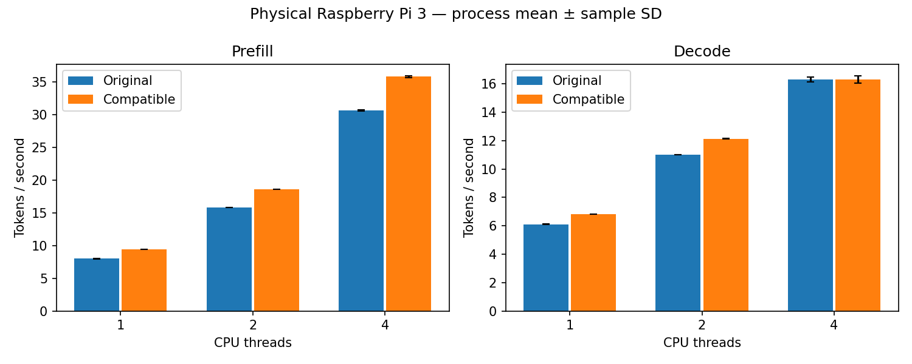

# Physical Pi 3: the plain two-row loop is accepted end to end

The plain two-row candidate **passed its kernel gate and is accepted under the rule
committed before measurement**. Prefill throughput rose 16.9–17.6% at every thread
count and decode rose 11.8% at one thread and 10.2% at two. Four-thread decode was
unchanged (-0.09%), inside the 1% non-inferiority margin that the rule set for that
group. Compile-time and runtime integration defaults remain off.

This result does **not** raise the board's highest decode throughput: the original
reaches about 16.3 t/s at four threads and so does the candidate.

## Kernel gate: passed

Capture ran on 2026-11-12 from 03:48:14 to 03:51:14 UTC from clean source
`aac9e4cbdb79f999db09e9995cf2ee1d73ea7da3`, on the engine-built library. Ratios above 1
mean the candidate was faster.

| Weights | Vectors per block | Original ns/row | Candidate ns/row | Original/candidate | Candidate wins |
|---:|---:|---:|---:|---:|---:|
| 76 KB | 1 | 649.53 | 508.10 | 1.2784 | 18/18 |
| 76 KB | 16 | 637.07 | 497.41 | 1.2808 | 18/18 |
| 608 KB | 1 | 661.81 | 522.52 | 1.2666 | 18/18 |
| 608 KB | 16 | 642.47 | 501.69 | 1.2806 | 18/18 |
| 6.5 MB | 1 | 671.59 | 545.14 | 1.2320 | 18/18 |
| 6.5 MB | 16 | 642.19 | 502.63 | 1.2777 | 18/18 |
| 104 MB | 1 | 672.37 | 544.64 | 1.2345 | 18/18 |
| 104 MB | 16 | 643.35 | 504.12 | 1.2762 | 18/18 |

Without hints the loop costs about 545 ns per row on large single-pass weights,
against about 509 with hints in the [earlier capture](q5_two_row_analysis.md) and 672
for the original. See the
[report](../reports/pi3-q5-two-row-plain-kernel-20261112/reuse.md) and
[evidence](../results/quantized/two-row-plain-kernel-20261112).

## End-to-end gate: accepted

Capture ran from 03:53:15 to 04:11:04 UTC from the same source, on the library whose
hashes the kernel capture recorded.

| Phase | Threads | Original mean t/s | Candidate mean t/s | Paired throughput change | Pairs favouring candidate | Requirement | Rule |
|---|---:|---:|---:|---:|---:|---|---|
| Prefill | 1 | 7.988961 | 9.393721 | +17.584% | 4/4 | improve | passes |
| Prefill | 2 | 15.845661 | 18.586284 | +17.296% | 4/4 | improve | passes |
| Prefill | 4 | 30.628506 | 35.814960 | +16.935% | 4/4 | improve | passes |
| Decode | 1 | 6.112383 | 6.830625 | +11.751% | 4/4 | improve | passes |
| Decode | 2 | 11.013670 | 12.138498 | +10.213% | 4/4 | improve | passes |
| Decode | 4 | 16.322505 | 16.308432 | -0.088% | 2/4 | within 1% | passes |

Each change is the mean of four within-pair candidate/original throughput ratios,
minus one. The generated [report](../reports/pi3-two-row-plain-e2e-20261112/e2e.md)
labels the candidate column "compatible" because the report code is unchanged. The
[verdict file](../reports/pi3-two-row-plain-e2e-20261112/two_row_gate.json) records
the rule and each group's outcome.

## How to read the acceptance

The rule for this candidate was written after the prefetching candidate had been
rejected on four-thread decode, and after exploratory runs suggested that group sits
at a ceiling. The [protocol](q5_two_row_plain.md) discloses both. Under the stricter
rule that rejected the prefetching candidate, this candidate would also have been
rejected: four-thread decode did not improve.

Four-thread decode behaved as that reading expected. The four pair ratios were
0.9859, 1.0109, 0.9936 and 1.0061, scattered around 1, and both variants averaged
16.3 t/s. This is consistent with a limit shared by the threads; it does not
establish one, and no performance counter was read.

Removing the hints cost part of the decode gain at one and two threads: 11.8% and
10.2% here against 15.9% and 13.8% for the prefetching candidate in its own capture.
Those are separate captures, not a paired comparison. Prefill was unaffected, at
about 17% in both.

## Controls and correctness

All 24 formal processes exited normally, giving 144 throughput samples with no
exclusions. The original binary and its four libraries matched the hashes of the
earlier end-to-end studies. The pinned graph harness passed on the Pi build. The
model gate had zero logit difference over 36 comparisons with matching greedy tokens,
and audited proofs showed candidate dispatch in both phases at 1, 2 and 4 threads.

## Operating conditions

Conditions were clean by the rule. All 1,008 end-to-end sensor samples and all 378
kernel samples read `throttled=0x0` at 1,200 MHz with none missing. Maximum
end-to-end temperature was 77.902 degrees Celsius, with 41 samples at or above 75;
cooling was not changed. One-second sampling cannot exclude shorter events.

## Limits

One board, one small model, random-token pp128/tg16 and four process pairs per group
limit generalization. Decode starts at depth 0 and is not greedy application
generation. Standard deviations in the report are descriptive, not confidence
intervals. The loop handles only the model's width-576 Q5 matrices, and nothing here
shows how it behaves on other models, widths or boards.

What limits four-thread decode remains open. If it is memory traffic, further gains
there would have to come from reading less, not from a faster loop.
