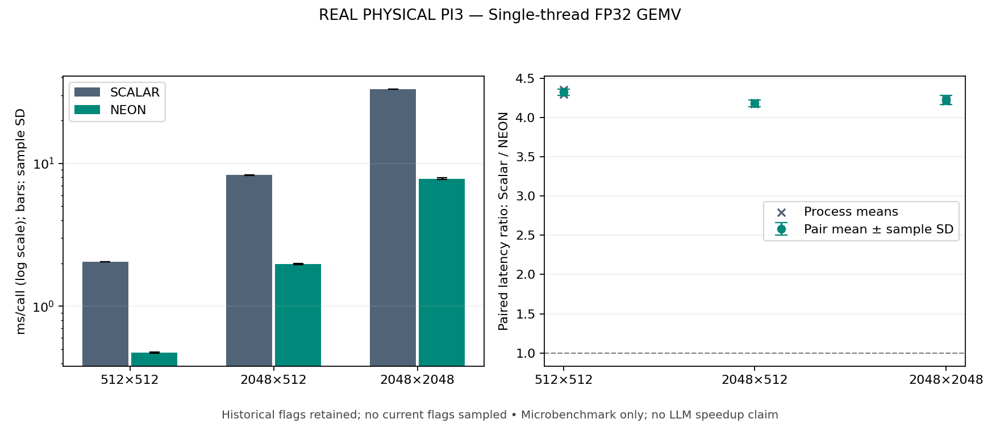

# Scalar / ARM NEON FP32 GEMV paired measurements

**REAL PHYSICAL PI3**

Synthetic matrices; single thread; no GGUF, INT4 or GGML integration. Ratios describe only this microbenchmark and do not establish an LLM speedup.

Measurement commit: `c1e477a773dec4e12d1f45866a4d07c849f14a9f`; dirty tree: `False`. Architecture: `aarch64`.
Device: Raspberry Pi 3 Model B Rev 1.2; kernel: `6.18.39+rpt-rpi-v8`; RAM (MiB): 905.10546875.
Governor before/after: `ondemand` / `ondemand`. Compiler settings are archived in the evidence directory.
Run: 2026-10-31T08:33:31.512068+00:00 to 2026-10-31T08:35:02.339518+00:00.

[9 successful processes / evidence](../../results/kernels/neon-20261031/manifest.json); 54 pairs. [All batch samples](../../results/kernels/neon-20261031/benchmark.csv).

| Matrix | Processes | Pairs | Scalar ms/call ± sample SD | NEON ms/call ± sample SD | Mean paired Scalar/NEON ratio ± sample SD |
|---|---:|---:|---:|---:|---:|
| 512×512 | 3 | 18 | 2.056064 ± 0.002426 | 0.475705 ± 0.004368 | 4.3225 ± 0.0385 |
| 2048×512 | 3 | 18 | 8.267522 ± 0.010851 | 1.978020 ± 0.020240 | 4.1801 ± 0.0415 |
| 2048×2048 | 3 | 18 | 33.013627 ± 0.052643 | 7.821108 ± 0.103050 | 4.2218 ± 0.0566 |

## Numerical and operating conditions

- 512×512: process-level mean ratios 4.2947, 4.3221, 4.3506; maximum absolute oracle error: Scalar 0.00018310547, NEON 1.5258789e-05.
- 2048×512: process-level mean ratios 4.1726, 4.1890, 4.1787; maximum absolute oracle error: Scalar 0.00032043457, NEON 3.0517578e-05.
- 2048×2048: process-level mean ratios 4.2080, 4.2393, 4.2181; maximum absolute oracle error: Scalar 0.001159668, NEON 0.00016784668.

Temperature samples (C): 39.704–42.932; frequency samples (MHz): 1200.000–1200.000; peak child RSS: 19.050781 MiB.
Current power/frequency flags observed: none. Historical flags observed: ['frequency_capped_occurred']. Missing throttle observations: 0/99.

No current flags were sampled; one-second observations do not exclude transients.
Historical flags can predate this run; compare the manifest's before/after snapshots. Telemetry spans initialization, calibration, timed batches and oracle checks.

## Protocol and limits

Each pair uses identical input buffers and independent calibrated batch counts. Order alternates Scalar→NEON and NEON→Scalar, with equal counts. Exact batch nanoseconds are divided by each kernel's iteration count before computing the per-pair latency ratio. The reported mean averages ratios, rather than dividing two overall means. Every result passes an independent long-double forward-error check; no bitwise Scalar/NEON equivalence is assumed.

Repeated buffers are not explicitly flushed; the working set need not fit cache. Calibration always checks Scalar before NEON. Batches within each process and sequential process sessions share machine state; sample SD is descriptive, not a confidence interval for independent sessions. No samples are discarded. There is no controlled ambient temperature, affinity or background-service isolation. The script changes no governor, clock, voltage, swap or boot settings. SIGKILL alone never proves OOM; consult process records for unavailable cgroup evidence.

The NEON implementation combines vector arithmetic and four accumulator chains; the ratio does not isolate the causal contribution of either change. These synthetic FP32 shapes are not identified quantized model hotspots. Profile actual inference before deciding whether to integrate an optimized kernel.

[Native JSON and telemetry](../../results/kernels/neon-20261031/raw), [derived summaries](../../results/kernels/neon-20261031/benchmark.json). Reproduce and regenerate using `docs/neon_gemv.md`. Published metadata normalization, if any, is documented in SOURCE.json.

