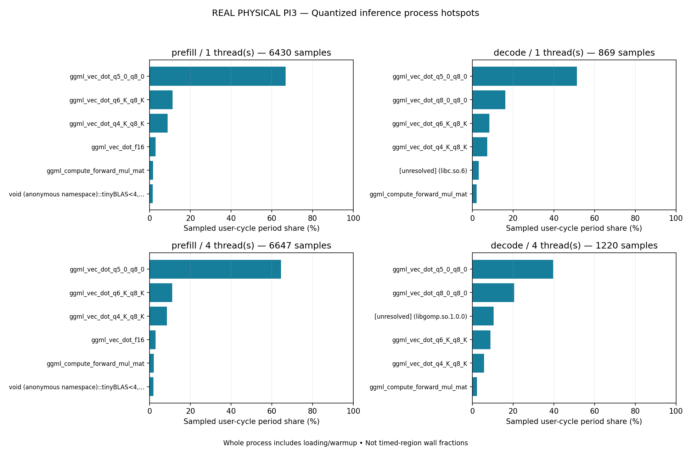

# Quantized inference: user-cycle function profiling

**REAL PHYSICAL PI3**

Sampling scope: the complete phase-oriented llama-bench process, including model loading, warmup, timed inference and teardown. Flat cycle-period percentages are user-CPU sampling weights, not fractions of timed-region wall time. No call graph or operator timing is inferred.

Project commit `1b0c39e9cf31e9d6bec1c9a255fea52f23fb0364`; engine `a7a98e0fffed794396b3fbad4dcdbbc184963645`.
Model SHA256 `2e8040ceae7815abe0dcb3540b9995eaa1fa0d2ca9e797d0a635ae4433c68c2d`.
Run: 2026-10-31T09:01:32.964042+00:00 to 2026-10-31T09:05:03.757768+00:00.

## Matched-parameter control and sampled runs

| Workload | Threads | Control mean ± SD (t/s) | Sampled mean ± SD (t/s) | Observed sampled/control ratio |
|---|---:|---:|---:|---:|
| prefill | 1 | 7.9941 ± 0.0008 | 7.9739 ± 0.0006 | 0.9975 |
| decode | 1 | 6.1053 ± 0.0017 | 6.1008 ± 0.0007 | 0.9993 |
| prefill | 4 | 30.5940 ± 0.2061 | 30.4682 ± 0.0888 | 0.9959 |
| decode | 4 | 16.0822 ± 0.5249 | 15.9420 ± 0.1942 | 0.9913 |

These ratios describe separate process runs with identical parameters and three timed repetitions each. They combine profiler perturbation and machine-state drift; they do not isolate a causal overhead percentage. Prefill and decode throughput remain separate.

## Phase-oriented function samples

### prefill, 1 thread(s)

Samples: 6430; sampled period sum: 76971992250; reported lost samples: 0; unresolved period share: 0.741%.

| Symbol | DSO | Samples | Sampled user-cycle period share |
|---|---|---:|---:|
| `ggml_vec_dot_q5_0_q8_0` | `libggml-cpu.so` | 4289 | 66.731% |
| `ggml_vec_dot_q6_K_q8_K` | `libggml-cpu.so` | 726 | 11.292% |
| `ggml_vec_dot_q4_K_q8_K` | `libggml-cpu.so` | 562 | 8.741% |
| `ggml_vec_dot_f16` | `libggml-cpu.so` | 188 | 2.923% |
| `ggml_compute_forward_mul_mat` | `libggml-cpu.so` | 108 | 1.681% |
| `void (anonymous namespace)::tinyBLAS<4, __Float32x4_t, __Float32x4_t, unsigned short, float, float>::gemm_bloc<4, 6>(long, long)` | `libggml-cpu.so` | 100 | 1.554% |
| `ggml_vec_dot_q8_0_q8_0` | `libggml-cpu.so` | 80 | 1.243% |
| `ggml_vec_swiglu_f32` | `libggml-cpu.so` | 49 | 0.764% |
| `[unresolved]` | `libc.so.6` | 43 | 0.741% |
| `ggml_cpu_fp32_to_fp16` | `libggml-cpu.so` | 39 | 0.606% |
| `ggml_vec_soft_max_f32` | `libggml-cpu.so` | 36 | 0.559% |
| `quantize_row_q8_K_ref` | `libggml-base.so` | 33 | 0.514% |

[Sanitized raw periods/symbols](../../results/profiling/pi3-20261031/raw/prefill-t1-d0-profile.samples.tsv). JSON/CSV retain all symbols, including unresolved ones; tables show the top twelve.

### decode, 1 thread(s)

Samples: 869; sampled period sum: 10251867858; reported lost samples: 0; unresolved period share: 3.251%.

| Symbol | DSO | Samples | Sampled user-cycle period share |
|---|---|---:|---:|
| `ggml_vec_dot_q5_0_q8_0` | `libggml-cpu.so` | 446 | 51.362% |
| `ggml_vec_dot_q8_0_q8_0` | `libggml-cpu.so` | 141 | 16.249% |
| `ggml_vec_dot_q6_K_q8_K` | `libggml-cpu.so` | 72 | 8.298% |
| `ggml_vec_dot_q4_K_q8_K` | `libggml-cpu.so` | 64 | 7.374% |
| `[unresolved]` | `libc.so.6` | 22 | 3.149% |
| `ggml_compute_forward_mul_mat` | `libggml-cpu.so` | 18 | 2.076% |
| `ggml_vec_dot_f16` | `libggml-cpu.so` | 12 | 1.383% |
| `quantize_row_q8_K_ref` | `libggml-base.so` | 5 | 0.576% |
| `ggml_vec_swiglu_f32` | `libggml-cpu.so` | 4 | 0.461% |
| `bool std::operator==<char, std::char_traits<char>, std::allocator<char> >(std::__cxx11::basic_string<char, std::char_traits<char>, std::allocator<char> > const&, char const*)` | `llama-bench` | 4 | 0.452% |
| `llama_vocab::~llama_vocab()` | `libllama.so` | 4 | 0.427% |
| `std::_Hash_bytes(void const*, unsigned long, unsigned long)` | `libstdc++.so.6.0.33` | 4 | 0.419% |

[Sanitized raw periods/symbols](../../results/profiling/pi3-20261031/raw/decode-t1-d0-profile.samples.tsv). JSON/CSV retain all symbols, including unresolved ones; tables show the top twelve.

### prefill, 4 thread(s)

Samples: 6647; sampled period sum: 78891129656; reported lost samples: 0; unresolved period share: 1.564%.

| Symbol | DSO | Samples | Sampled user-cycle period share |
|---|---|---:|---:|
| `ggml_vec_dot_q5_0_q8_0` | `libggml-cpu.so` | 4260 | 64.506% |
| `ggml_vec_dot_q6_K_q8_K` | `libggml-cpu.so` | 738 | 11.141% |
| `ggml_vec_dot_q4_K_q8_K` | `libggml-cpu.so` | 563 | 8.471% |
| `ggml_vec_dot_f16` | `libggml-cpu.so` | 194 | 2.934% |
| `ggml_compute_forward_mul_mat` | `libggml-cpu.so` | 129 | 1.939% |
| `void (anonymous namespace)::tinyBLAS<4, __Float32x4_t, __Float32x4_t, unsigned short, float, float>::gemm_bloc<4, 6>(long, long)` | `libggml-cpu.so` | 119 | 1.782% |
| `ggml_vec_dot_q8_0_q8_0` | `libggml-cpu.so` | 92 | 1.384% |
| `[unresolved]` | `libc.so.6` | 60 | 0.786% |
| `[unresolved]` | `libgomp.so.1.0.0` | 57 | 0.778% |
| `quantize_row_q8_0` | `libggml-cpu.so` | 49 | 0.734% |
| `ggml_vec_swiglu_f32` | `libggml-cpu.so` | 45 | 0.678% |
| `ggml_cpu_fp32_to_fp16` | `libggml-cpu.so` | 41 | 0.599% |

[Sanitized raw periods/symbols](../../results/profiling/pi3-20261031/raw/prefill-t4-d0-profile.samples.tsv). JSON/CSV retain all symbols, including unresolved ones; tables show the top twelve.

### decode, 4 thread(s)

Samples: 1220; sampled period sum: 14406439302; reported lost samples: 0; unresolved period share: 12.181%.

| Symbol | DSO | Samples | Sampled user-cycle period share |
|---|---|---:|---:|
| `ggml_vec_dot_q5_0_q8_0` | `libggml-cpu.so` | 450 | 39.660% |
| `ggml_vec_dot_q8_0_q8_0` | `libggml-cpu.so` | 242 | 20.555% |
| `[unresolved]` | `libgomp.so.1.0.0` | 138 | 10.434% |
| `ggml_vec_dot_q6_K_q8_K` | `libggml-cpu.so` | 111 | 8.928% |
| `ggml_vec_dot_q4_K_q8_K` | `libggml-cpu.so` | 70 | 5.824% |
| `ggml_compute_forward_mul_mat` | `libggml-cpu.so` | 28 | 2.191% |
| `[unresolved]` | `libc.so.6` | 34 | 1.746% |
| `ggml_vec_dot_f16` | `libggml-cpu.so` | 14 | 1.119% |
| `ggml_vec_swiglu_f32` | `libggml-cpu.so` | 8 | 0.650% |
| `ggml_graph_compute_thread.isra.0` | `libggml-cpu.so` | 7 | 0.562% |
| `gguf_get_tensor_name` | `libggml-base.so` | 1 | 0.547% |
| `unicode_utf8_to_byte(std::__cxx11::basic_string<char, std::char_traits<char>, std::allocator<char> > const&)` | `libllama.so` | 6 | 0.492% |

[Sanitized raw periods/symbols](../../results/profiling/pi3-20261031/raw/decode-t4-d0-profile.samples.tsv). JSON/CSV retain all symbols, including unresolved ones; tables show the top twelve.

## Actual GGUF storage inventory

This table describes stored tensor types, not runtime time fractions. File-level Q4_K_M does not imply that every tensor is Q4_K. Shapes use GGML's inner-dimension-first order.

| Type | Tensors | Parameters/elements | Storage MiB | Share of tensor bytes |
|---|---:|---:|---:|---:|
| Q5_0 | 166 | 78077952 | 51.1919 | 51.779% |
| Q8_0 | 15 | 29859840 | 30.2563 | 30.603% |
| Q6_K | 14 | 12386304 | 9.6899 | 9.801% |
| Q4_K | 16 | 14155776 | 7.5938 | 7.681% |
| F32 | 61 | 35136 | 0.1340 | 0.136% |

[Tensor descriptors and architecture metadata](../../results/profiling/pi3-20261031/model_inventory.json).

## Operating conditions and limitations

Maximum sampled temperature (C): 68.218. Frequency sample range (MHz): 1200.0–1200.0. Power/frequency flags observed: ['frequency_capped_occurred']. Missing throttle readings: 0/211.

No current flag was sampled; one-second observations cannot exclude transients.
Historical flags may predate this run. See before/after snapshots and telemetry. Live profiled RSS belongs to perf; its wait4 peak includes waited descendants and is not benchmark-only RSS. Direct controls retain their own process metrics.

A 99-Hz target does not produce a complete census of CPU cycles. Variable sample periods are summed; sample counts are not substituted for cycle weights. Lost/unresolved samples, initialization, warmup and scheduler/barrier work affect interpretation. CPU cycles spent spinning do not equal critical-path wall time. No stack attribution or cache/DRAM bottleneck is established by this experiment. Ambient conditions, affinity and background activity are uncontrolled. No security, clock, governor, voltage, swap or boot changes.

Original perf.data and address-bearing script dumps remain private. Public evidence retains each period, DSO basename and symbol, plus hashes of the private sources. Addresses and absolute paths are removed; unresolved addresses are grouped explicitly. The manifest hashes public inputs. Additional normalization is documented in SOURCE.json.

[Native benchmark/process/telemetry evidence](../../results/profiling/pi3-20261031/raw) and [hash manifest](../../results/profiling/pi3-20261031/manifest.json). Reproduce with `docs/inference_profiling.md`. These profiles select candidates; they establish no custom-kernel or LLM speedup.

