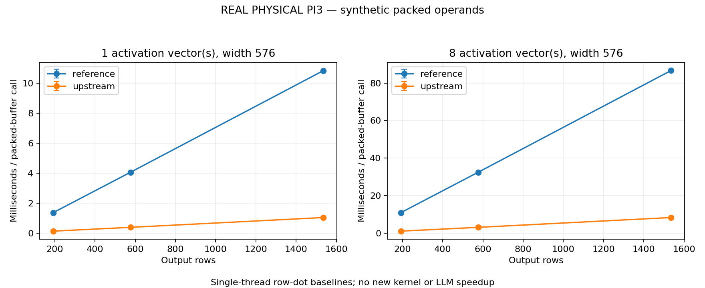

# Q5_0×Q8_0: correctness and upstream baseline

**REAL PHYSICAL PI3 — synthetic packed operands**

The reference is deliberately scalar and disables automatic vectorization. Upstream already uses its ARM vectorized implementation. Ratios describe two existing baselines, not a new optimization or LLM speedup.

Source `866a07461309a46fa130defd61607aa3d3494019`; engine `a7a98e0fffed794396b3fbad4dcdbbc184963645`. Run 2026-10-31T13:27:19.597627+00:00 to 2026-10-31T13:28:19.647168+00:00.

Each call evaluates rows × vectors serial dot products of width 576 with reused synthetic packed buffers. Vectors=1/8 are decode-shaped / multi-vector probes; they do not reproduce full GGML matrix dispatch or pp128. Activation quantization, allocation, initialization and decoded FP64 oracle checks are excluded from timing. No threading, cache flush or affinity/governor change.

| Rows | Vectors | Reference mean ± sample SD (ms/call) | Upstream mean ± sample SD (ms/call) | Mean paired reference/upstream |
|---|---:|---:|---:|---:|
| 192 | 1 | 1.3615 ± 0.0472 | 0.1270 ± 0.0002 | 10.7169 |
| 192 | 8 | 10.8895 ± 0.3736 | 1.0165 ± 0.0010 | 10.7130 |
| 576 | 1 | 4.0552 ± 0.0066 | 0.3808 ± 0.0004 | 10.6498 |
| 576 | 8 | 32.4126 ± 0.0229 | 3.0446 ± 0.0039 | 10.6458 |
| 1536 | 1 | 10.8455 ± 0.0179 | 1.0352 ± 0.0015 | 10.4772 |
| 1536 | 8 | 86.7316 ± 0.0805 | 8.2768 ± 0.0131 | 10.4789 |

SD pools the timed batches across process sessions; paired samples within a process are not independent process trials. JSON retains per-process means and every paired ratio; no confidence interval or significance claim is made. Case order reverses in alternating sessions; each process balances reference/upstream batch order. Reference calibration always precedes upstream calibration.

## Independent numerical checks

The real-device gate exhausts finite binary16 patterns and signed zero in the reference decoder. Both dots then face single-lane golden fixtures for all 32 Q5 integers at all 32 positions, Q8 extrema, odd/even block tails and randomized decoded FP64 oracles. Fixture gates are synthetic replay. Formal outputs are checked before timing and after every paired batch. The oracle decodes each operand, multiplies in FP64 and sums per element; it does not reuse the scalar integer block dot. The bound is `1e-6 + gamma * sum(abs(products))`, with `gamma = 8*(blocks+1)*epsilon_float / (1 - 8*(blocks+1)*epsilon_float)`. It is a conservative forward-error allowance, not quantization error against original FP32 weights.

| Process | Reference max abs error | Upstream max abs error | Largest error/bound |
|---|---:|---:|---:|
| s01-m192-v1 | 0.00022606552 | 0.00019532442 | 0.0012212 |
| s01-m192-v8 | 0.00046188384 | 0.00030924194 | 0.0018943 |
| s01-m576-v1 | 0.00030566659 | 0.00023156684 | 0.00214321 |
| s01-m576-v8 | 0.00039242581 | 0.00030246377 | 0.00319491 |
| s01-m1536-v1 | 0.00038484856 | 0.00029997155 | 0.00240786 |
| s01-m1536-v8 | 0.00041690469 | 0.00038169324 | 0.00249508 |
| s02-m1536-v8 | 0.00047536194 | 0.00029521808 | 0.00236307 |
| s02-m1536-v1 | 0.00023498572 | 0.00020717643 | 0.0016587 |
| s02-m576-v8 | 0.00041248742 | 0.00024642423 | 0.00275779 |
| s02-m576-v1 | 0.00030513573 | 0.00020082574 | 0.00169049 |
| s02-m192-v8 | 0.0003284514 | 0.0003678808 | 0.00212834 |
| s02-m192-v1 | 0.00012574345 | 0.00016785879 | 0.0015533 |
| s03-m192-v1 | 0.00019933749 | 0.00023100153 | 0.00139619 |
| s03-m192-v8 | 0.00027192384 | 0.00025624782 | 0.00185297 |
| s03-m576-v1 | 0.00035386253 | 0.00021101441 | 0.00324193 |
| s03-m576-v8 | 0.00044494774 | 0.00028747413 | 0.00324193 |
| s03-m1536-v1 | 0.00035466626 | 0.00024145562 | 0.00228356 |
| s03-m1536-v8 | 0.00069280341 | 0.00034227967 | 0.00340017 |

## Operating conditions and limitations

Peak child RSS (MiB): 19.9375. Maximum sampled temperature (C): 43.47. Frequency range (MHz): 600.0–1200.0. Flags observed: ['frequency_capped_occurred']. Missing throttle samples: 0/76.

One-second readings include setup/calibration/oracle work and can miss transients. Historical flags may predate this experiment. Inspect per-process records for failures, timeout and OOM evidence; SIGKILL alone never establishes OOM. Synthetic integers and finite normal scales are reproducible test operands, not extracted model weights or measured activation distributions. This measures single-thread hot/reused-buffer row-dot loops; full prefill tiling, activation quantization, cache-cold behavior, concurrency and end-to-end inference remain separate experiments.

No optimized quantized candidate is implemented here. Before any replacement, preserve this packed-layout contract, independent oracle and original upstream comparator, then demonstrate repeatable gains on physical hardware and rerun separate pp/tg inference benchmarks.

[Hash manifest](../../results/quantized/q5-20261031/manifest.json), [native JSON/process/sensors](../../results/quantized/q5-20261031/raw). CSV identifies each source file, SHA256 and paired repetition. Compiler metadata and upstream library hashes are retained; publication normalization, if any, is documented in SOURCE.json.

