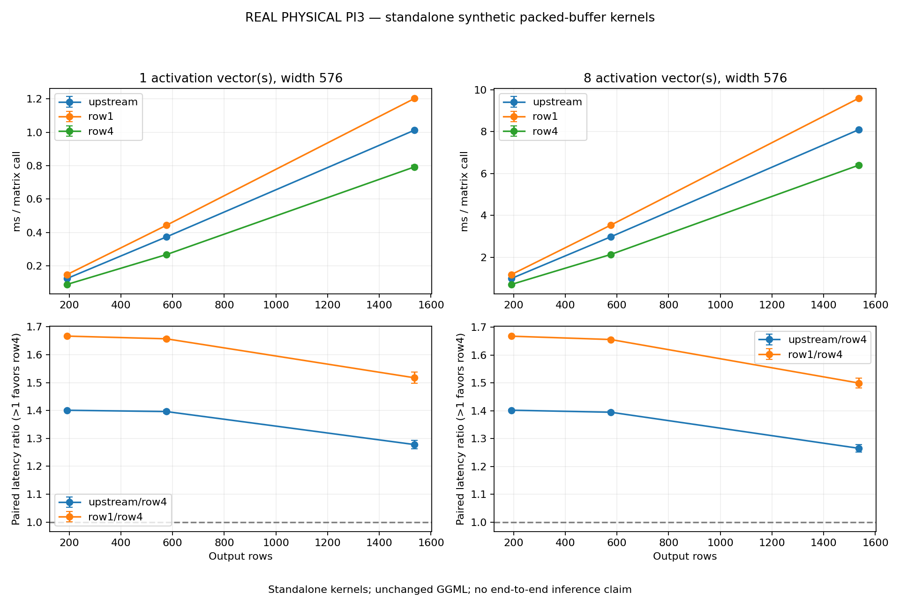

# Q5_0×Q8_0 NEON candidate vs original ARM GGML

**REAL PHYSICAL PI3 — standalone synthetic packed-buffer kernels**

Capture source `3edd72745e2ac661cfd236f8039a93dcb9db2992`; engine `a7a98e0fffed794396b3fbad4dcdbbc184963645`.
Run 2026-10-31T14:07:09.909620+00:00 to 2026-10-31T14:08:28.057216+00:00.

The comparator is the original exported GGML row-dot function. Row1 uses the new NEON decode/reduction without cross-row reuse; row4 shares activation loads and scale conversion across up to four output rows. No packed-format conversion is added.

| Rows | Vectors | Upstream mean ± SD (ms) | Row1 mean ± SD (ms) | Row4 mean ± SD (ms) | Mean upstream/row4 | Mean row1/row4 |
|---:|---:|---:|---:|---:|---:|---:|
| 192 | 1 | 0.1244 ± 0.0003 | 0.1480 ± 0.0002 | 0.0888 ± 0.0002 | 1.4009 | 1.6668 |
| 192 | 8 | 0.9933 ± 0.0013 | 1.1816 ± 0.0008 | 0.7087 ± 0.0009 | 1.4017 | 1.6674 |
| 576 | 1 | 0.3731 ± 0.0007 | 0.4428 ± 0.0005 | 0.2672 ± 0.0007 | 1.3963 | 1.6571 |
| 576 | 8 | 2.9799 ± 0.0037 | 3.5378 ± 0.0019 | 2.1370 ± 0.0057 | 1.3944 | 1.6555 |
| 1536 | 1 | 1.0124 ± 0.0029 | 1.2021 ± 0.0035 | 0.7924 ± 0.0102 | 1.2779 | 1.5174 |
| 1536 | 8 | 8.0950 ± 0.0112 | 9.5946 ± 0.0140 | 6.4005 ± 0.0702 | 1.2649 | 1.4992 |

Each value covers a complete serial packed-buffer matrix call, not an LLM token. Ratio >1 means row4 has lower latency in that matched triplet; <1 is a regression. All six three-variant permutations balance timing position; calibration order rotates by process-session seed. Independent iteration counts are normalized before ratios.

Pooled SD is descriptive. Triplets inside a process are not independent process trials. JSON retains per-process means, every triplet and session ratios. There is no confidence interval, significance or causal cache/DRAM claim.

## Numerical evidence

Both candidates and the original comparator must pass independent per-element decoded FP64 oracles before timing and after every triplet. The candidate gate also checks all finite binary16 scales in both operand positions, every Q5 integer/lane with Q8 extrema, row/block tails, matrix vectors, overflow guards and the worst int16 folding magnitude. Fixture gates are synthetic replay, not hardware validation.

Candidate reduction/FMA order differs from upstream. The bound is the existing `1e-6 + gamma * sum(abs(products))`, with `gamma=8*(blocks+1)*epsilon_float / (1-8*(blocks+1)*epsilon_float)`. This checks arithmetic on packed operands, not model quantization error or quality. Checksums need not match bitwise.

| Rows | Vectors | Upstream max error/bound | Row1 max error/bound | Row4 max error/bound |
|---:|---:|---:|---:|---:|
| 192 | 1 | 0.0015533 | 0.00177425 | 0.00177425 |
| 192 | 8 | 0.00212834 | 0.00194413 | 0.00194413 |
| 576 | 1 | 0.00159488 | 0.00173535 | 0.00173535 |
| 576 | 8 | 0.00163298 | 0.00185166 | 0.00185166 |
| 1536 | 1 | 0.00167938 | 0.00195519 | 0.00195519 |
| 1536 | 8 | 0.00222675 | 0.00248472 | 0.00248472 |

## Operating conditions and limits

Maximum sampled temperature (C): 45.622. Frequency range (MHz): 1200.0–1200.0. Peak direct-child RSS (MiB): 20.34375.
Flags observed: ['frequency_capped_occurred']. Missing throttle readings: 0/94.

One-second samples include initialization/calibration/oracle work and can miss transients; historical flags can predate this experiment. Peak RSS includes the child lifecycle and can include pre-exec memory. Process failure/timeout/OOM evidence stays explicit; a signal alone is not an OOM diagnosis. No clock/governor/voltage/security/boot/swap changes.

Synthetic packed inputs, one thread, reused buffers, no cache flush or affinity pinning. Allocation, quantization, initialization and oracle computation are excluded. Vectors=8 is a small serial multi-vector probe, not pp128 or full GGML tiled dispatch. Candidate matrix entry points replace many upstream row-dot calls; ratios include call/interface, compiler, decode/reduction and blocking differences. The row1 ablation narrows this comparison but does not isolate one instruction or memory effect.

These standalone kernel results do not establish an end-to-end LLM speedup. The engine is unchanged. Integration requires layout/dispatch validation and fresh separate pp/tg measurements; neutral/negative cases must remain visible.

[Hash manifest](../../results/quantized/neon-20261031/manifest.json), [raw native/process/sensors](../../results/quantized/neon-20261031/raw). CSV maps each triplet to raw input SHA256. Only allowlisted build provenance is public; full build logs, compiler dumps and assembly remain private.

