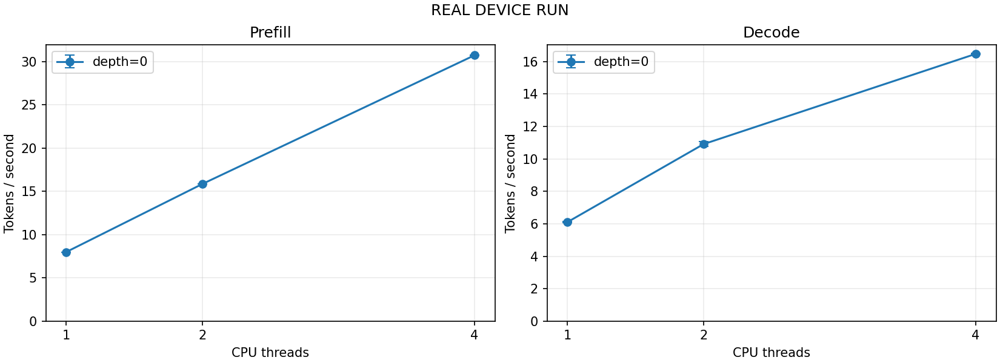

# Raspberry Pi 3 baseline

**REAL DEVICE RUN**

Real Raspberry Pi 3 run; inspect telemetry and failures.


## Environment and reproducibility

- Device: Raspberry Pi 3 Model B Rev 1.2
- Architecture: aarch64
- OS: 'PRETTY_NAME="Debian GNU/Linux 13 (trixie)"\nNAME="Debian GNU/Linux"\nVERSION_ID="13"\nVERSION="13 (trixie)"\nVERSION_CODENAME=trixie\nDEBIAN_VERSION_FULL=13.6\nID=debian\nHOME_URL="https://www.debian.org/"\nSUPPORT_URL="https://www.debian.org/support"\nBUG_REPORT_URL="https://bugs.debian.org/"'
- Kernel: 6.18.39+rpt-rpi-v8
- Cores: 4
- RAM (MiB): 905.10546875
- CPU features: ['fp', 'asimd', 'evtstrm', 'crc32', 'cpuid']
- llama.cpp: `a7a98e0fffed794396b3fbad4dcdbbc184963645`
- Model: `SmolLM2-135M-Instruct-Q4_K_M.gguf`
- Model SHA256: `2e8040ceae7815abe0dcb3540b9995eaa1fa0d2ca9e797d0a635ae4433c68c2d`
- Model revision: `09816acd5d99df7be770d85ea30822623dab342c`
- Started: 2026-10-31T07:17:10.577051+00:00; finished: 2026-10-31T07:20:13.445106+00:00
- Run status: ok; suite: baseline

Protocol: `{"batch_size": 128, "cooldown_s": 5, "gpu_layers": 0, "mmap": true, "ordering": "depth, threads 1/2/4, prefill then decode", "sample_interval_s": 1, "timeout_s": 1800, "ubatch_size": 128, "warmup": "native default enabled"}`

## Throughput

| Phase | Depth | Threads | Samples (t/s) | Mean ± sample SD (t/s) | Efficiency | Peak RSS (MiB) | Source |
|---|---:|---:|---|---:|---:|---:|---|
| prefill | 0 | 1 | 7.9908, 7.9900, 7.9898 | 7.9902 ± 0.0005 | 1.000 | 130.84 | `raw/prefill-t1-d0.json` row 0 |
| decode | 0 | 1 | 6.0554, 6.1313, 6.1282 | 6.1050 ± 0.0430 | 1.000 | 125.52 | `raw/decode-t1-d0.json` row 0 |
| prefill | 0 | 2 | 15.8479, 15.8491, 15.8487 | 15.8486 ± 0.0006 | 0.992 | 130.89 | `raw/prefill-t2-d0.json` row 0 |
| decode | 0 | 2 | 10.7324, 10.9954, 10.9920 | 10.9066 ± 0.1509 | 0.893 | 125.52 | `raw/decode-t2-d0.json` row 0 |
| prefill | 0 | 4 | 30.6511, 30.7372, 30.7593 | 30.7159 ± 0.0571 | 0.961 | 130.50 | `raw/prefill-t4-d0.json` row 0 |
| decode | 0 | 4 | 16.4306, 16.4853, 16.4799 | 16.4653 ± 0.0301 | 0.674 | 125.52 | `raw/decode-t4-d0.json` row 0 |



## Resources and reliability

Resource values below cover whole benchmark processes including model load and warmup.

```json
{
  "samples": 152,
  "aggregation": {
    "temperature_c": "maximum",
    "frequency_mhz": "minimum",
    "available_memory_mb": "minimum",
    "cpu_utilization_pct": "mean"
  },
  "temperature_c": 65.528,
  "frequency_mhz": 600.0,
  "available_memory_mb": 619.1796875,
  "cpu_utilization_pct": 41.57373488799906,
  "throttle_flags_observed": [],
  "throttle_missing_samples": 0,
  "unavailable_reasons": [
    "No prior CPU sample",
    "Unavailable (KeyError)"
  ],
  "warnings": []
}
```

## Failures and OOM evidence

```json
[]
```


## Analysis and limitations

Compare phases and context depths separately. Efficiency is (throughput at T threads / throughput at 1 thread) / T. This is thread scaling within an unmodified backend, not a custom-kernel optimization claim.
Highest observed depth-0 prefill throughput in this run: 4 thread(s); see the table and raw samples.
Highest observed depth-0 decode throughput in this run: 4 thread(s); see the table and raw samples.

CV > 10% heuristic flagged: none among successful cases.
Only three timed repetitions are used; this is not a confidence interval or a stability proof.
Decode at depth 0 starts with an empty cache; it does not follow the 128-token prefill test. The context suite uses native --n-depth to prefill the cache outside the timed region.
Peak RSS uses Linux wait4 per child, not whole-system or process-tree memory. Periodic VmHWM/RSS and sensors are also retained. All MB columns mean MiB.
CPU utilization is whole-system busy time (0–100%), not process CPU percent. Frequency sampling uses cpu0 as a representative core; 1-second sampling can miss short events.
Historical throttle bits can predate this run; missing vcgencmd means unknown, not no throttling.
SIGKILL is not proof of OOM. Cgroup OOM counter deltas are supporting, shared-scope evidence; confirm with locally reviewed kernel logs before attributing OOM to this benchmark.
Model loading, native warmup and cooldown affect conditions. Fixed order and uncontrolled ambient temperature, background services, cooling, power and swap limit causal conclusions.

Every throughput sample maps to raw_file + raw_row_index + repetition (1-based) in benchmark.csv. Raw SHA256 is verified when regenerating reports. Keep the entire run directory with its raw evidence.
